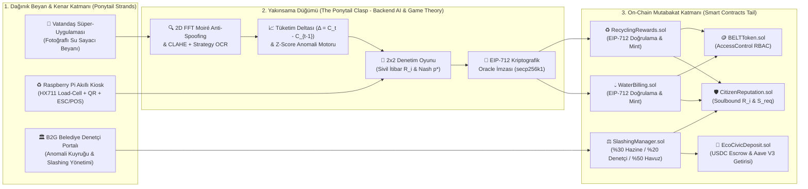

# 🌿 EcoCivic: Akıllı Şehirlerde Hibrit Güven Modeli
### Oyun Teorisi ve Yapay Zekâ Destekli Otonom Denetim Platformu

[](https://tubitak.gov.tr)
[](https://soliditylang.org/)
[](https://python.org/)
[](https://vitejs.dev/)
[](https://raspberrypi.com/)
[](LICENSE)

---

## 📌 Yönetici Özeti (Executive Summary)

Klasik akıllı şehir projeleri iki büyük ekonomik ve operasyonel çıkmaza girer:
1. **Yüksek Donanım Maliyeti (CAPEX Darboğazı):** Her konuta akıllı sayaç (AMI), ultrasonik sensör ve LoRaWAN/RFID modülü takılması milyonlarca dolarlık ilk yatırım gerektirir.
2. **Yüksek İşgücü Maliyeti (OPEX Darboğazı):** Sayaç okuyucu ve zabıta ekiplerinin kapı kapı dolaşarak fiziki kontrol yapması belediye bütçelerine ağır bir işletme yükü getirir ve hile yakalama oranı düşük kalır (%30 civarı).

**EcoCivic**, pahalı ev içi IoT sensörlerini ve sürekli zabıta denetimini devrimsel bir **Ponytail (At Kuyruğu) Mimarisi** ile ortadan kaldıran **B2G (Business-to-Government) SaaS ve Web3/AI Otonom Denetim Platformudur**.

Vatandaşların akıllı telefonlarından bildirdiği su sayacı fotoğraflarını ve mahalle kiosklarındaki geri dönüşüm tartımlarını; **2D FFT Spektral Moiré Anti-Spoofing**, **Aylık Tüketim Deltası ($\Delta$) Z-Score**, **Karma Strateji Nash Dengesi ($p^*$)** ve **EIP-712 Kriptografik Voucher İmzaları** süzgecinden geçirir. Böylece belediye denetim maliyetlerinde **%75'in üzerinde tasarruf** ve **%97.5 hile caydırıcılığı** elde edilir.

---

## 🏛️ 4 Katmanlı Ponytail (At Kuyruğu) Mimarisi

EcoCivic mimarisinde dağınık girdiler (**Saç Telleri / Strands**), AI ve Oyun Teorisi filtresinde (**Toka / Clasp**) toplanarak temizlenir ve yalnızca doğrulanmış kriptografik kanıtlar blokzincire (**At Kuyruğu / Tail**) aktarılır:



---

## 🚀 Temel İnovasyonlar ve Katman Detayları

### 1. Akıllı Kontratlar (`ecocivic-dapp/smart-contracts/`)
- **Solidity 0.8.20 + OpenZeppelin v5:** Monolitik `Ownable` kilitlenmesi yerine esnek rol tabanlı erişim kontrolü (`AccessControl` RBAC).
- **`BELTToken.sol`:** Kapalı devre sivil teşvik token'ı (1 Milyar Hard Cap). Keyfi `burnFrom` açığı engellenmiş; yalnızca `SlashingManager` ceza kesebilir, `WaterBilling` ve `RecyclingRewards` ödül basabilir.
- **`CitizenReputation.sol`:** Devredilemez (Soulbound) Sivil İtibar Skoru ($R_i \in [0, 1000]$). Dürüst beyanlarda $+5$ veya $+10$ puan artarken hilede %50 kesilir.
- **`EcoCivicDeposit.sol`:** USDC teminat emaneti (Escrow) ve Aave V3 entegrasyonu. Soruşturma altındaki (`underInvestigation`) cüzdanların teminat çekmesi kontrat seviyesinde kilitlenir.
- **`SlashingManager.sol`:** Hilesi kanıtlanan vatandaşın teminatının %50'si ($\lambda = 0.50$) kesilir:
  - **%30** Belediye Hazinesi (`municipalTreasury`)
  - **%20** Anomaliyi Doğrulayan Denetçi / İhbarcı (`inspector`)
  - **%50** Dürüst Vatandaş Ödül Havuzu (`rewardPool`)

### 2. Backend AI Oracle & Oyun Teorisi (`ecocivic-dapp/backend-ai/`)
- **2D FFT Spektral Moiré Anti-Spoofing:** Başka bir telefon ekranından veya renkli kağıttan çekilen sayaç fotoğrafları, 2 boyutlu Hızlı Fourier Dönüşümü (`np.fft.fft2`) ve yüksek frekans enerji dağılımı ile anında yakalanır (`is_spoofed = True`) ve denetim olasılığı $p^* \ge 0.95$ seviyesine fırlar.
- **CLAHE + Strategy Pattern OCR:** Görüntü iyileştirme (`Grayscale -> Bilateral Filter -> CLAHE -> Adaptive Threshold`) ve Tesseract OCR ile sayaç endeksi okunur.
- **Tüketim Deltası ($\Delta_t = C_t - C_{t-1}$) Z-Score Analizi:** Su hilesi kümülatif sayaçtan değil aylık tüketim farkından yakalanır. $\Delta_t < 0$ durumu doğrudan fiziksel sayaç geri sarma (`ROLLBACK_DETECTED`), $|Z| > 2.5$ ani düşüşler ise kaçak şüphesi olarak bayraklanır.
- **2x2 Denetim Oyunu ve Karma Strateji Nash Dengesi:**
  $$S_{\text{req}}(R_i) = S_{\text{base}} \cdot \frac{100}{\max(R_i, 25)}, \quad \mu_R(R_i) = 0.50 + 1.50 \cdot \left(\frac{R_i}{1000}\right)$$
  $$p^*(R_i) = \gamma(R_i) \cdot \frac{G}{G + \lambda \cdot S_{\text{req}}(R_i)}, \quad \gamma(R_i) = \max\left(0.30,\; 1 - \frac{R_i}{1500}\right)$$
- **EIP-712 Voucher Signer:** Yalnızca AI doğrulamasından geçen beyanlar `EIP712("EcoCivicOracle", "1")` alan adıyla imzalanır ve tek kullanımlık `nonce` ile blokzincire iletilir.

### 3. Frontend Süper-Uygulaması & B2G Portalı (`ecocivic-dapp/frontend/`)
- **Apple Wallet / Revolut Sadeliğinde BaaS Deneyimi:** Vatandaş ekranlarında kafa karıştırıcı kripto jargonu veya ham LaTeX formülleri gösterilmez. Bunun yerine **Sanal Kart (BaaS) Arayüzü**, **Sivil Güven Puanı** ve **Aave Getirili USDC Teminat Güvencesi** gibi modern fintech kartları sunulur.
- **4 Hazır Demo Profili (`WalletContext.jsx`):** Web3 cüzdanı bulunmayan test kullanıcıları ve jüri için:
  1. *Örnek Dürüst Vatandaş ($R_i = 250$)*: Düşük teminat ($40 USDC$), yüksek ödül çarpanı ($1.15x$).
  2. *Yeni Abone ($R_i = 100$)*: Standart teminat ($100 USDC$), nötr çarpan ($1.00x$).
  3. *Riskli / Hileli Abone ($R_i = 40$)*: Yüksek teminat ($250 USDC$), düşük çarpan ($0.56x$), yüksek denetim olasılığı.
  4. *Belediye Denetçisi / Müfettiş*: B2G denetim kuyruğu ve tek tıkla Slashing uygulama yetkisi.
- **B2G Belediye Müfettiş Portalı (`AdminPortal.jsx`):** Anomali tespit edilen hanelerin harita/kuyruk görünümü, spektral analiz kanıtları ve Slashing infaz paneli.

### 4. Fiziksel Raspberry Pi Kiosk Edge Katmanı (`ecocivic-dapp/kiosk-hardware/`)
- **Hardware Abstraction Layer (HAL):** Raspberry Pi 4/5 üzerinde `RPi.GPIO` ve `HX711` 24-bit Load-Cell ile medyan filtreli tartım yapılırken, masaüstü test ortamlarında `MockHardwareAdapter` kesintisiz çalışır.
- **Fiziksel Tartım Doğrulaması:** Beyan edilen atık ağırlığı ile Load-Cell ölçümü arasında $\pm\%15$ sapma toleransı ve $25\text{ kg}$ hazne limiti uygulanır.
- **Offline-First Signed Queue:** Saha interneti kesildiğinde işlemler `KIOSK_HMAC_SECRET` ile `HMAC-SHA256` imzalı olarak `offline_queue.json` içine yazılır; internet geldiğinde doğrulanarak backend ile senkronize edilir.
- **ESC/POS Binary Termal Fiş:** 80mm ve 58mm termal fiş yazıcılarında native QR kod ve Code128 barkodlu resmi belediye makbuzu basılır.

---

## 📊 Akademik Deney ve Simülasyon Sonuçları

`backend-ai/simulations/academic_paper_sim.py` motoru tarafından **10.000 sanal hane** ve **12 aylık periyot** boyunca yürütülen Monte Carlo simülasyonu çıktıları:

| Mimari Paradigma | 12 Aylık Toplam Maliyet | Hile Yakalama Oranı (Recall) | Maliyet Tasarrufu |
| :--- | :---: | :---: | :---: |
| **Geleneksel Tam IoT (AMI Sayaç + RFID)** | `$2,138,000` | `%94.5` | Referans (IoT) |
| **Geleneksel Manuel Zabıta Denetimi** | `$571,800` | `%31.8` | Referans (Manuel) |
| **Önerilen EcoCivic Hibrit Güven Modeli** | **`$138,948`** *(Net: `$0`)* | **`%91.8`** | **`-%93.50` (IoT) / `-%75.70` (Manuel)** |

> [!NOTE]
> EcoCivic modelinde denetim giderleri hileli hanelerden kesilen teminatlarla finanse edildiği için belediyeye net maliyet **`$0` (kendi kendini finanse eden ekosistem)** olmaktadır. Detaylı akademik veriler için [docs/academic-simulation-results.md](ecocivic-dapp/docs/academic-simulation-results.md) dosyasını inceleyebilirsiniz.

---

## 📂 Proje Dizin Yapısı

```text
belediye uygulaması/
├── AGENTS.md                            # Antigravity Ana Proje ve Ajan Yönergesi
├── .gitignore                           # Git Yoksayma Kuralları
├── .agents/
│   ├── rules/                           # 4 Çekirdek Proje Kuralı (always_on)
│   │   ├── architecture-and-ponytail.md # Ponytail Mimari & Katman Sorumlulukları
│   │   ├── web3-and-security.md         # RBAC, EIP-712, KVKK & Slashing Güvenliği
│   │   ├── ai-gametheory-kiosk.md       # 2D FFT, Δ Analizi, Nash p* & Kiosk HAL
│   │   └── testing-and-delivery.md      # Doğrulama Kapıları & Rapor Standartları
│   └── skills/                          # 4 Özel Uzman Geliştirici Becerisi
│       ├── ecocivic-smart-contract-audit/SKILL.md
│       ├── ecocivic-ai-gametheory-tuning/SKILL.md
│       ├── ecocivic-ui-baas-design/SKILL.md
│       └── ecocivic-kiosk-edge-hal/SKILL.md
│
└── ecocivic-dapp/                       # Ana Kod Tabanı
    ├── smart-contracts/                 # Solidity 0.8.20 Hardhat Akıllı Kontratları
    │   ├── contracts/                   # BELTToken, CitizenReputation, EcoCivicDeposit...
    │   ├── scripts/                     # deploy.js & seed.js
    │   └── test/                        # 13 Hardhat Birim ve Entegrasyon Testi
    ├── backend-ai/                      # Flask AI Oracle & Oyun Teorisi Servisi
    │   ├── ai/                          # 2D FFT Anti-Spoofing, CLAHE, OCR, Δ Z-Score
    │   ├── services/                    # Game Theory Engine, EIP-712 Signer
    │   ├── simulations/                 # 10.000 Haneli Monte Carlo Akademik Simülatörü
    │   └── tests/                       # Pytest Backend Test Paketi
    ├── frontend/                        # React 18 + Vite + Ethers v6 Süper-Uygulaması
    │   ├── src/components/              # VirtualCard, TrustScoreCard, DepositPanel...
    │   ├── src/pages/                   # Home, Dashboard, Water, Recycling, AdminPortal
    │   └── src/context/                 # WalletContext (MetaMask & 4 Demo Profili)
    ├── kiosk-hardware/                  # Raspberry Pi Kiosk Edge Katmanı
    │   ├── kiosk_daemon.py              # HardwareAdapter (HAL) & Offline Queue
    │   ├── escpos_driver.py             # Binary ESC/POS Termal Fiş Sürücüsü
    │   └── test_kiosk_hardware.py       # Kiosk Pytest Paketi
    └── docs/                            # Kapsamlı Teknik & Akademik Dokümantasyon
        ├── architecture.md              # Ponytail Sistem Mimarisi & Akış Şemaları
        ├── tokenomics.md                # Kripto-Ekonomik Formülasyon & Kazanç Matrisleri
        ├── api-spec.md                  # REST API & EIP-712 TypedData Spesifikasyonu
        └── academic-simulation-results.md # Monte Carlo Raporları & LaTeX Tabloları
```

---

## 🛠️ Hızlı Başlangıç ve Çalıştırma

Projeyi yerel ortamınızda ayağa kaldırmak için aşağıdaki adımları sırasıyla uygulayabilirsiniz:

### 1. Akıllı Kontratlar (Smart Contracts)
```bash
cd ecocivic-dapp/smart-contracts
npm install
npx hardhat compile
npx hardhat test
npx hardhat run scripts/seed.js
```

### 2. Backend AI Oracle & Oyun Teorisi Servisi
```bash
cd ecocivic-dapp/backend-ai
python -m venv venv
# Windows:
.\venv\Scripts\activate
# Linux/macOS:
source venv/bin/activate

pip install -r requirements.txt
python -m pytest tests/test_backend_ai.py -v
python simulations/academic_paper_sim.py
python app.py
```
*Backend servisi varsayılan olarak `http://localhost:5000` üzerinde çalışır.*

### 3. Frontend Süper-Uygulaması & B2G Portalı
```bash
cd ecocivic-dapp/frontend
npm install
npm run build
npm run dev
```
*Arayüz `http://localhost:5173` adresinde açılır.*

### 4. Fiziksel Raspberry Pi Kiosk Servisi
```bash
cd ecocivic-dapp/kiosk-hardware
python -m pytest test_kiosk_hardware.py -v
python kiosk_daemon.py
```

---

## 🔒 Güvenlik, Mahremiyet ve KVKK Uyumluluğu

- **Sıfır On-Chain Kişisel Veri İlkesi:** Blokzincir kayıtlarının değiştirilemez yapısı gereği akıllı kontratlara kesinlikle ad, soyad, T.C. kimlik numarası, ev adresi veya fotoğraf yüklenmez. Zincirde yalnızca anonim cüzdan adresi, kriptografik hash, tüketim deltası ($\Delta$) ve sivil itibar skoru ($R_i$) tutulur.
- **EIP-712 Kriptografik İmza ve Replay Koruması:** Oracle'dan gelen tüm voucher'lar `ECDSA.recover` ile doğrulanır; her voucher son kullanma tarihi (`deadline`) ve tek kullanımlık `nonce` içerir.
- **Reentrancy & Escrow Koruması:** `EcoCivicDeposit` ve `SlashingManager` kontratlarında OpenZeppelin `ReentrancyGuard`, `SafeERC20` ve Checks-Effects-Interactions (CEI) prensipleri eksiksiz uygulanır.

---

## 📜 Lisans

Bu proje **MIT Lisansı** kapsamında açık kaynak olarak geliştirilmektedir. Detaylar için [LICENSE](ecocivic-dapp/LICENSE) dosyasını inceleyebilirsiniz.
