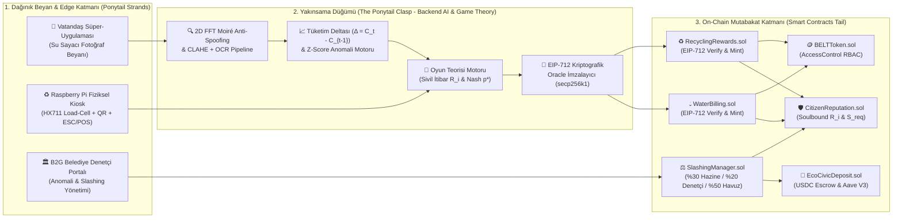
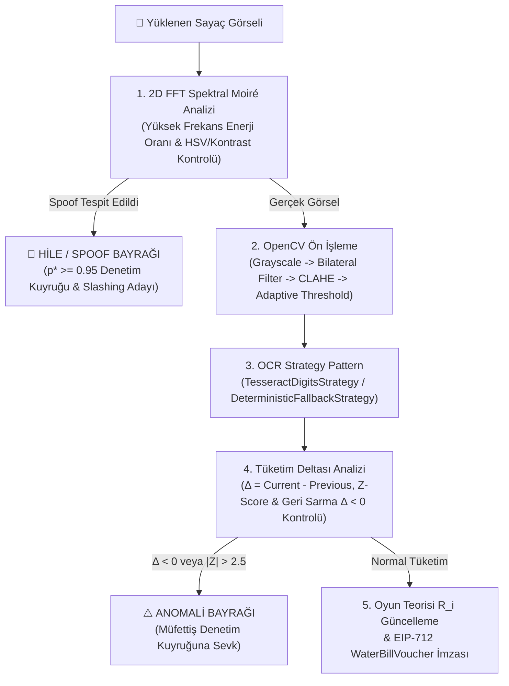
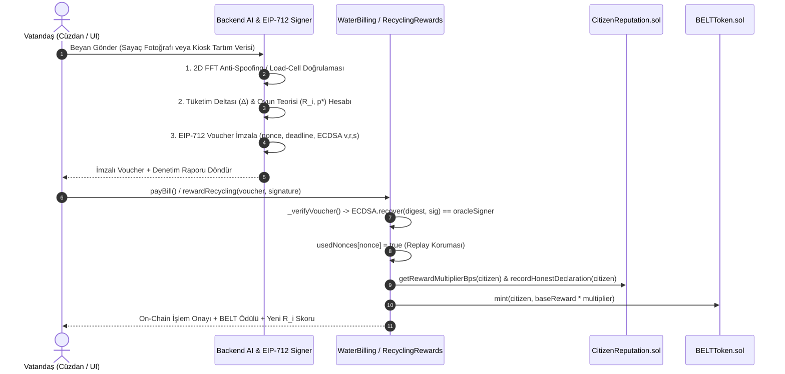
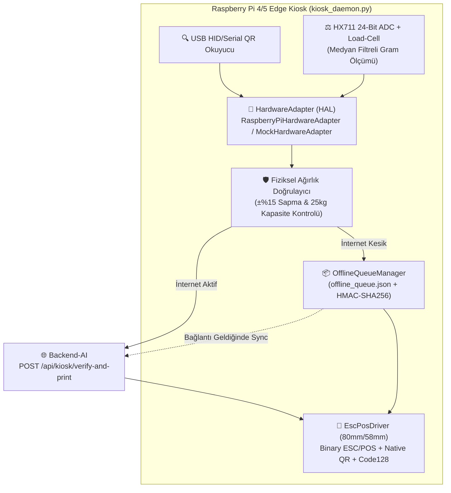

# 🏛️ EcoCivic Ponytail Sistem Mimarisi (Clean Architecture & Web3/AI Hibrit Tasarım)

**Proje:** Akıllı Şehirlerde Hibrit Güven Modeli: Oyun Teorisi ve Yapay Zeka Destekli Otonom Denetim (TÜBİTAK 2209-B)  
**Mimari Desen:** *Ponytail Architecture (At Kuyruğu Mimarisi)* + *Clean Architecture* + *Strategy & Pipeline Pattern* + *Hardware Abstraction Layer (HAL)*

---

## 1. Ponytail (At Kuyruğu) Mimari Felsefesi

Geleneksel akıllı şehir projeleri her haneye pahalı IoT sensörleri yerleştirmeye çalışırken yüksek **CAPEX/OPEX** darboğazına girer. **EcoCivic Ponytail Mimarisi**, binlerce dağınık sivil beyan ve kenar (edge) donanım girdisini (**Saç Telleri / Dağınık Girdi Katmanı**), merkezi olmayan kriptografik **AI Oracle + Oyun Teorisi Denetim Düğümünde (Toka / Yakınsama Noktası)** süzgeçten geçirerek, yalnızca doğrulanmış ve **EIP-712** ile imzalanmış kanıtları **Akıllı Kontratlara (At Kuyruğu / On-Chain Mutabakat Katmanı)** iletir.

---

## 2. 5 Aşamalı Görüntü İşleme, Anti-Spoofing ve OCR Pipeline (`backend-ai/ai/`)

Su sayacı beyanlarında ekran fotoğrafı (screen-replay) veya kağıt çıktı sahteciliğini engellemek için `ai/model_utils.py` ve `ai/ocr.py` içinde **Pipeline + Strategy Pattern** uygulanmıştır:

---

## 3. EIP-712 Kriptografik Doğrulama ve On-Chain Mutabakat Akışı

Oracle manipülasyonunu ve tekrar (replay) saldırılarını önlemek amacıyla zincir dışı AI doğrulaması ile zincir üstü kontratlar arasında **EIP-712 Structured Data Hashing & Signing** standardı kullanılır:

---

## 4. Fiziksel Raspberry Pi Edge Kiosk Mimarisi (`kiosk-hardware/`)

TÜBİTAK 2209-B İP4 iş paketi kapsamında saha kioskları **Hardware Abstraction Layer (HAL)** ve **Offline-First Signed Queue** mimarisiyle tasarlanmıştır:

---

## 5. Akıllı Kontrat Modülerliği ve RBAC Yetki Matrisi (`smart-contracts/`)

Monolitik kontrat darboğazını ve `Ownable` kilitlenmesini (Ownership Deadlock) ortadan kaldırmak için OpenZeppelin `AccessControl` tabanlı 6 modüler kontrat inşa edilmiştir:

| Kontrat Dosyası | Sorumluluk | Sahip Olduğu / Kullandığı Roller ve Güvenlik Katmanı |
| :--- | :--- | :--- |
| `BELTToken.sol` | Kapalı devre sivil teşvik token'ı (ERC-20, 1B Max Supply) | `DEFAULT_ADMIN_ROLE`, `MINTER_ROLE`, `BURNER_ROLE`, `SLASHING_ROLE`, `PAUSER_ROLE` |
| `CitizenReputation.sol` | Soulbound (devredilemez) Sivil İtibar Skoru ($R_i \in [0, 1000]$) | `REPUTATION_UPDATER_ROLE`, `SLASHER_ROLE`; dinamik $S_{\text{req}}$ ve $\mu_R$ hesabı |
| `EcoCivicDeposit.sol` | USDC Teminat (Escrow) ve Aave V3 Getiri Adaptörü | `SLASHER_ROLE`, `ReentrancyGuard`, `underInvestigation` çekim kilidi |
| `WaterBilling.sol` | EIP-712 Su Beyanı Doğrulama, Faturalama ve Tasarruf Ödülü | `EIP712("EcoCivicOracle", "1")`, `ECDSA`, `BELTToken.MINTER_ROLE` |
| `RecyclingRewards.sol` | EIP-712 Atık Beyanı Doğrulama ve Kiosk Ödül Dağıtımı | `EIP712("EcoCivicOracle", "1")`, `usedNonces` replay koruması, `MINTER_ROLE` |
| `SlashingManager.sol` | Hile tespiti halinde otomatik/müfettiş onaylı teminat ve itibar kesintisi | `%30` Belediye Hazinesi, `%20` Denetçi, `%50` Sivil Ödül Havuzu; `SLASHER_ROLE` |
